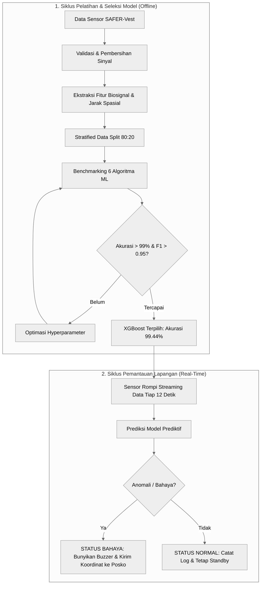

# SAFER-Vest: Klasifikasi Peringatan Keselamatan Berbasis Sensor

[](https://www.python.org/)
[](https://scikit-learn.org/)
[](https://xgboost.ai/)
[](https://pandas.pydata.org/)
[](https://numpy.org/)
[](https://jupyter.org/)

Model klasifikasi prediktif untuk mendeteksi kondisi darurat relawan lapangan secara otomatis dari telemetri sensor rompi keselamatan pintar **SAFER-Vest** (detak jantung, gerak tubuh, dan koordinat GPS).

---

## 1. Arsitektur Alur Kerja Sistem

Arsitektur sistem dibagi menjadi dua siklus kerja: **Siklus Pelatihan Model (*Offline*)** untuk melatih dan memilih model AI terbaik, serta **Siklus Inferensi Lapangan (*Real-Time*)** saat rompi dipakai bertugas:



### Penjelasan Ringkas Alur Sistem:
* **Fase Pelatihan:** Data telemetri mentah dibersihkan dan diperkaya dengan variabel lonjakan denyut nadi (*rolling mean BPM*) serta jarak radius posko. Enam algoritma diuji dan dioptimasi hingga model XGBoost mencapai batas performa tinggi (akurasi 99.44% dan F1 0.9545).
* **Fase Operasional:** Model yang terpilih diintegrasikan ke sistem pemantauan. Jika sensor mendeteksi lonjakan BPM ekstrem atau relawan terjatuh tanpa gerakan (*NO MOTION*), sistem seketika membunyikan *buzzer* rompi dan memancarkan koordinat GPS darurat ke posko komando. Sebaliknya, saat data fisiologis normal, sistem berada dalam mode siaga (*standby*).

---

## 2. Teknologi yang Digunakan

Proyek ini dibangun menggunakan *tech stack* data science dan machine learning standar industri:

<p align="left">
  
  
  
  
  
  
  
  
</p>

| Komponen | Pustaka / Tools | Peran dalam Sistem SAFER-Vest |
| :--- | :--- | :--- |
| **Bahasa Utama** |  | Fondasi utama komputasi numerik, manipulasi data, dan orkestrasi pemodelan AI |
| **Manipulasi & Rekayasa Data** |   | Mengolah data telemetri sensor Excel, agregasi denyut nadi per relawan, dan perhitungan jarak koordinat GPS |
| **Machine Learning Core** |  | Preprocessing data (penskalaan fitur & stratified split), pelatihan 5 model klasik, dan kalkulasi metrik evaluasi |
| **Gradient Boosting Engine** |  | Algoritma utama berakurasi tinggi (99.44%) untuk menangani interaksi non-linear kompleks antarsensor |
| **Visualisasi Data** |   | Eksplorasi data sensor (EDA), visualisasi distribusi detak jantung, sebaran GPS, dan heatmap matriks konfusi |
| **Lingkungan Interaktif** |  | Media eksperimen terstruktur dan dokumentasi sel per sel pada [index.ipynb](index.ipynb) |

### Peran Khusus Setiap Komponen:
1. **Pandas & NumPy:** Membersihkan 3.547 rekaman sensor, membuat fitur *rolling window* denyut nadi (menangkap tren lonjakan bertahap), serta menghitung deviasi jarak relawan dari posko darurat menggunakan kalkulasi vektor spasial.
2. **Scikit-Learn:** Melakukan standarisasi skala (*StandardScaler*) agar model berbasis jarak (KNN dan SVM) tidak bias terhadap perbedaan satuan angka, serta membagi data secara *stratified* (80:20) agar proporsi insiden bahaya seimbang.
3. **XGBoost:** Menjadi model utama yang menggabungkan pohon keputusan secara bertahap (*boosting*), membedakan kondisi bahaya nyata dari fluktuasi normal dengan akurasi 99.44% dan hanya 1 alarm palsu.
4. **Matplotlib & Seaborn:** Merender grafik distribusi detak jantung, pemetaan titik operasi GPS, dan visualisasi matriks konfusi untuk audit performa model.
5. **Jupyter Notebook:** Menyajikan alur analisis sel per sel yang modular, rapi (*clean code*), dan dapat langsung diaudit tanpa perlu menjalankan ulang dari nol.

---

## 3. Alasan Pemilihan Algoritma

Enam algoritma machine learning diuji untuk membandingkan pendekatan linier, jarak, pohon keputusan, dan boosting:

* **XGBoost Classifier:** Algoritma *gradient boosting* yang mengoreksi kesalahan prediksi secara berulang. Dipilih karena paling andal menangani interaksi rumit antara lonjakan denyut nadi, status gerak, dan posisi spasial untuk mencapai akurasi tertinggi.
* **Random Forest:** Kumpulan ratusan pohon keputusan independen yang mengambil keputusan lewat voting terbanyak. Dipilih karena sangat stabil, tahan terhadap *overfitting*, dan memberikan estimasi signifikansi fitur yang baik.
* **Support Vector Machine (SVM):** Mencari garis pemisah dengan jarak maksimal antar-kelas menggunakan kernel non-linear RBF. Efektif mengelompokkan kondisi darurat pada data berskala seragam.
* **Decision Tree:** Model berbasis aturan logika *if-else* transparan. Dipilih karena perilakunya mudah diaudit oleh tim medis lapangan dan dapat dikonversi langsung ke bahasa C untuk mikrokontroler rompi.
* **K-Nearest Neighbors (KNN):** Menentukan status relawan berdasarkan kedekatan pola data di sekitarnya. Cocok untuk mendeteksi kesamaan profil denyut jantung dan kedekatan koordinat lokasi bahaya.
* **Logistic Regression:** Model linier probabilistik dasar. Digunakan sebagai *baseline* pembanding untuk menguji apakah pola kondisi darurat bisa dipisahkan secara linier sederhana sebelum memakai model kompleks.

---

## 4. Hasil Komparasi Model

Evaluasi diuji secara ketat pada 20% data uji independen (710 sampel) dengan metode *Stratified Sampling* untuk menjaga proporsi kejadian bahaya:

| Model | Akurasi | Presisi | Recall | F1-Score | Catatan Evaluasi |
| :--- | :---: | :---: | :---: | :---: | :--- |
| **XGBoost Classifier** | **99.44%** | **97.67%** | **93.33%** | **0.9545** | **Performa Terbaik:** Hanya 1 false alarm, mendeteksi 42/45 bahaya |
| **Random Forest** | 97.89% | 94.12% | 71.11% | 0.8101 | Sangat presisi, namun recall masih di bawah XGBoost |
| **SVM (RBF Kernel)** | 97.75% | 85.37% | 77.78% | 0.8140 | Stabil setelah penskalaan fitur (*StandardScaler*) |
| **Decision Tree** | 97.46% | 88.57% | 68.89% | 0.7750 | Logika ringkas, cocok untuk firmware edge perangkat |
| **K-Nearest Neighbors** | 97.18% | 82.05% | 71.11% | 0.7619 | Efektif pada klaster spasial, sensitif terhadap outlier |
| **Logistic Regression** | 96.48% | 85.71% | 53.33% | 0.6575 | Baseline linier, belum optimal menangkap interaksi non-linear |

---

## 5. Kesimpulan & Interpretasi Lapangan

1. **Denyut Jantung sebagai Sinyal Utama:**
   Fitur *rolling mean BPM* dan nilai detak jantung riil menjadi variabel paling menentukan (>40% skor *feature importance*). Rata-rata denyut nadi relawan saat kondisi bahaya melonjak mendekati 150 BPM (puncak 187 BPM) dibandingkan kondisi normal (~106 BPM), menandakan kelelahan fisik ekstrem atau stres operasional berat.
2. **Korelasi Gerak Tubuh & Spasial:**
   Kondisi tidak bergerak (*NO MOTION*) saat denyut jantung tetap tinggi atau berada di radius deviasi tertentu mengindikasikan relawan terjatuh, pingsan, atau terjebak reruntuhan.
3. **Rekomendasi Deployment Dua Tingkat (*Dual-Tier*):**
   * **Tingkat 1 (Rompi / Edge):** Gunakan aturan dari model **Decision Tree** pada mikrokontroler rompi agar peringatan suara *buzzer* tetap berbunyi instan tanpa butuh koneksi internet.
   * **Tingkat 2 (Posko Induk / Cloud):** Gunakan model **XGBoost Classifier** pada backend pemantauan untuk menerima data telemetri seluruh regu relawan secara terpusat dengan akurasi 99.44%.

---

## 6. Struktur Berkas

```text
SAFER-Vest/
├── index.ipynb                    # Notebook analisis data, EDA, pemodelan, & evaluasi
├── safer_vest_dataset_dummy.xlsx  # Dataset telemetri sensor relawan (3.547 baris)
└── README.md                      # Dokumentasi teknis proyek
```

---

## 7. Cara Menjalankan Proyek

1. **Clone atau buka folder proyek:**
   ```bash
   cd /home/iklil/SAFER-Vest
   ```

2. **Instal dependensi yang diperlukan:**
   ```bash
   pip install pandas numpy matplotlib seaborn scikit-learn xgboost openpyxl jupyter
   ```

3. **Buka dan jalankan notebook:**
   ```bash
   jupyter notebook index.ipynb
   ```
   Seluruh sel pada [index.ipynb](index.ipynb) sudah tersimpan dalam keadaan selesai dieksekusi, sehingga seluruh grafik dan hasil tabel metrik dapat langsung ditinjau.
